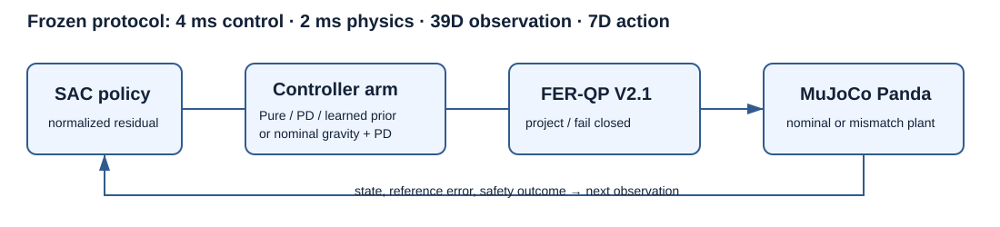
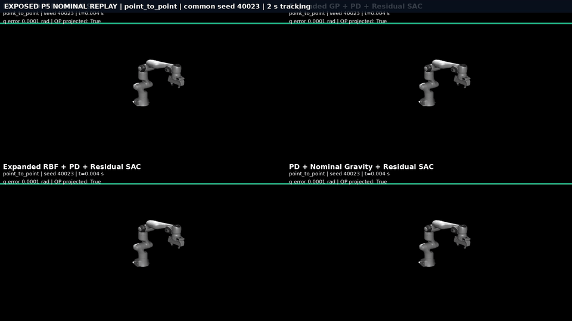
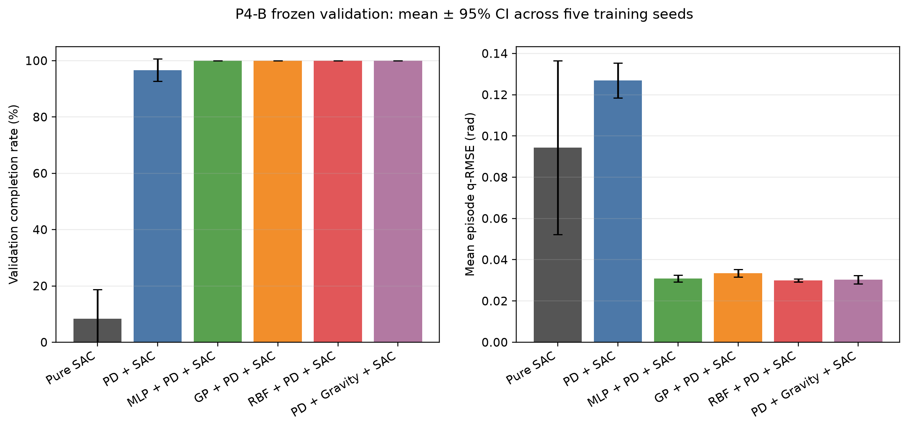
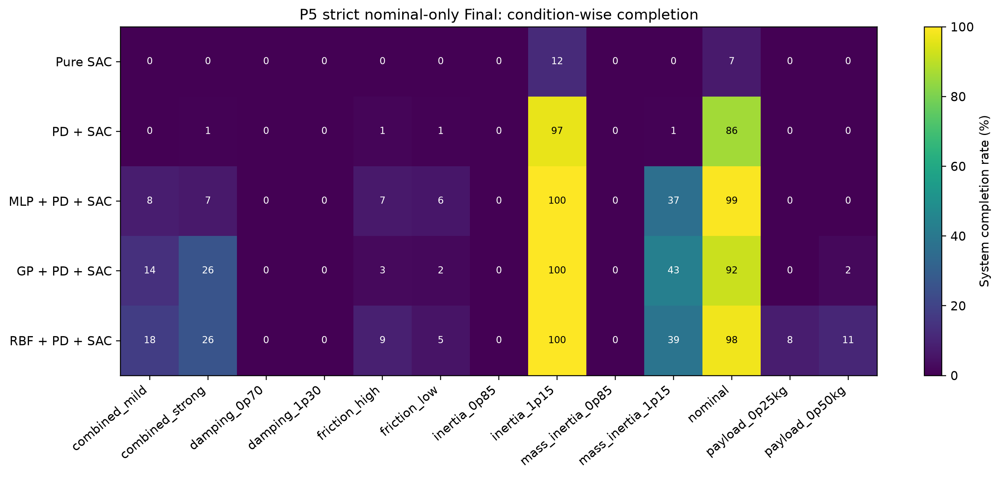

# Dynamics Priors for Safety-Constrained Residual SAC on a 7-DOF Franka Panda

An empirical MuJoCo study of whether frozen, simulation-trained inverse-dynamics priors assist residual SAC under common feedback control and a fail-closed safety QP. It evaluates nominal control and zero-shot forward-plant mismatch; it does not establish real-robot performance, FCI/ISO compliance, or hardware safety certification.

> **Release status:** this is a source/configuration public candidate. Frozen models, policies, numerical results, figures, and media remain pending owner distribution and license decisions. See [artifact availability](docs/ARTIFACT_AVAILABILITY.md).





The GIF and [1080p showcase MP4](docs/assets/demos/main_showcase_reel.mp4) are exposed-scenario diagnostics, not additional P4/P5 evaluation evidence.

## Questions and method

The study asks whether frozen MLP, expanded-GP, or expanded-RBF dynamics priors improve residual SAC relative to Pure SAC and PD+Residual SAC, whether effects persist under forward-plant mismatch, and how they compare with analytical nominal gravity compensation. The learned priors are simulation-trained (MLP-3000/seed41, GP-6000/g468, RBF-30000/1536/w3); historical real-data work is provenance only.

The 7-DOF Panda is torque controlled at 4 ms with a 2 ms physics step. The environment has a 39-dimensional observation and normalized seven-dimensional action. Every arm passes through FER-QP V2.1, which projects requests against torque, slew, position, velocity, and nominal-model acceleration constraints and fails closed on monitored outcomes.

| Arm | Composition | P5 status |
|---|---|---|
| Pure SAC | SAC torque action | Confirmatory |
| PD + Residual SAC | PD + SAC residual | Confirmatory |
| MLP / GP / RBF + PD + Residual SAC | frozen learned prior + PD + SAC residual | Confirmatory |
| PD + Gravity + Residual SAC | analytical nominal gravity + PD + SAC residual; no learned prior | Post-hoc exploratory |

Strict P5 isolates the controller with an independent nominal control model; mismatch is applied only to the forward plant. This does not make nominal-model QP a guarantee of actual mismatched-plant acceleration safety.

## Frozen evidence summary

The local full project contains 30 selected policies (15.0M transitions) and 360 saved P4 validation episodes. P4 selected checkpoints and is not an untouched test set; its 12 IDs correspond to nine unique reference trajectories.

| Arm | P4 completion / 60 | Mean P4 prefix q-RMSE (rad) | Strict P5 completion / 1950 |
|---|---:|---:|---:|
| Pure SAC | 5 | 0.09439 | 29 (1.49%) |
| PD + Residual | 58 | 0.12690 | 279 (14.31%) |
| MLP + PD + Residual | 60 | 0.03084 | 395 (20.26%) |
| GP + PD + Residual | 60 | 0.03352 | 423 (21.69%) |
| RBF + PD + Residual | 60 | 0.03001 | 470 (24.10%) |
| PD + Gravity + Residual | 60 | 0.03034 | 20.46% (post-hoc; not comparable) |

P5 aggregates are descriptive, not statistical-superiority claims. Completion is low in many mismatch conditions and `acceleration_limit` dominates failure. Prefix RMSE for terminated episodes is not full-trajectory tracking RMSE.





Selected aggregate CSVs used for the showcase are in [`docs/assets/data/`](docs/assets/data/); they are not the full episode corpus. See [`docs/assets/ASSET_PROVENANCE.md`](docs/assets/ASSET_PROVENANCE.md).

## Reproduction levels

Python 3.11 is required. `requirements.lock` is version-pinned but not a complete hash/transitive lock.

```bash
python -m venv .venv
. .venv/bin/activate
python -m pip install --upgrade pip
python -m pip install numpy==2.2.6 scipy==1.15.2 gymnasium==1.0.0 mujoco==3.3.5 pytest
python -m pip install -e . --no-deps
PYTHONPATH=src python tools/public_preflight.py
PYTHONPATH=src python -m pytest -q
```

This is Level A: installation, imports, configuration, and artifact-free tests. For local full replay, install the version-pinned `requirements.lock` first, then install the project with `--no-deps`. Level B frozen-artifact smoke testing and Level C saved-result recomputation require the owner-controlled bundle:

```bash
PYTHONPATH=src python tools/verify_migration.py
PYTHONPATH=src python tools/recompute_saved_results.py
```

They do not train policies or rerun final P5. A public clone must not promise Levels B/C until legal artifact distribution is approved.

## Demonstrations, layout, and limits

The showcase includes owner-authorized exposed-scenario diagnostic replays, including a retained fail-closed mismatch case. They are not extra P4/P5 evidence.

- `src/franka_dynamics_priors/`: environment, priors, nominal control, FER-QP.
- `configs/`: frozen P2–P5 records; `assets/`: Panda MJCF/meshes.
- `tools/`: public preflight and local artifact verification; `tests/`: artifact-free tests.
- `docs/`: report, limitations, release and distribution audits.

Ignored roots (`models/`, `policies/`, `results/`, `visualization/`, `internal_archive/`) belong to `FULL_LOCAL_PROJECT`, not `GITHUB_PUBLIC_CANDIDATE`.

Learned priors beat Pure SAC and PD-without-gravity on strict-P5 aggregates, but PD+Gravity is post-hoc and does not establish a stable learned-prior benefit over analytical gravity. The experiment is finite and simulation-only; it demonstrates neither robust all-condition safety nor real-robot readiness. See [limitations](docs/LIMITATIONS.md), [license audit](docs/LICENSE_AUDIT.md), [notices](docs/THIRD_PARTY_NOTICES.md), and [release precheck](docs/GITHUB_RELEASE_PRECHECK.md).

## License

**Original project source code is licensed under Apache-2.0.** Third-party assets remain under their respective licenses and notices. The selected figures, aggregate CSVs, GIF, and MP4 are included as Owner-authorized showcase material; they are not software relicensed by Apache-2.0. Frozen model weights and full research artifacts are not distributed. See [LICENSE](LICENSE), [NOTICE](NOTICE), and [asset/license audit](docs/LICENSE_AUDIT.md).
